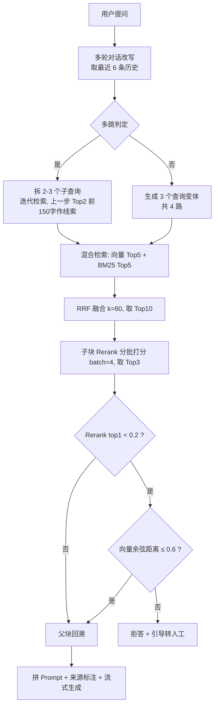

# 企业智能服务台（模块化 RAG 问答系统）· 项目描述报告

> 对应仓目录：`D:\rag`（remote: `https://github.com/GCVECV/enterprise-rag-qa.git`）
> 报告生成日期：2026-11-05
> 口径声明：本报告所有参数、阈值、成绩均取自仓库当前代码与评测留档，不含推测值；凡属局限与缺陷的部分单列在第八节，不做美化。

---

## 一、项目概览

| 项 | 内容 |
|---|---|
| 项目名称 | 企业智能服务台（模块化 RAG 问答系统） |
| 一句话定位 | 面向企业内部制度/IT/HR 文档的检索增强问答系统，主打"答得准、答不出来就拒答" |
| 技术栈 | Streamlit 1.65 + ChromaDB 1.5.9（HNSW/cosine）+ sentence-transformers 6.1 + BM25(jieba) + LangChain Core + DeepSeek-Chat |
| 模型 | Embedding `BAAI/bge-small-zh-v1.5`；Rerank `BAAI/bge-reranker-base`（CrossEncoder）；LLM `deepseek-chat`（temperature 0.1） |
| 代码规模 | 9 个 Python 模块，源码合计 61,236 字节（其中评测脚本 `eval_rag.py` 31,783 字节） |
| 文档解析 | pdfplumber 逐页 + 表格结构化（`table_parser.py`）；docx2txt（DOCX，纯文本）；UTF-8 直读（TXT）。**不含 OCR，图片与扫描件不支持**，见 4.1 |
| 交付形态 | 本地 Streamlit 应用 + 命令行评测脚本 |
| 核心能力 | 父子分块 / 混合检索 / RRF 融合 / Rerank 重排 / 父块回溯 / 多轮改写 / 多查询变体 / 多跳分解 / 双信号拒答 / 流式生成 / 增量入库 |

### 模块职责

| 文件 | 职责 |
|---|---|
| `app.py` | 应用入口：页面配置、会话状态、持久化知识库加载、侧边栏（上传/清空）、快捷提问、提问入口 |
| `config.py` | 全局配置：HF 镜像端点、路径、Rerank 阈值、双信号距离阈值、父子分块参数 |
| `llm.py` | 公共 LLM 客户端（DeepSeek） |
| `query_analysis.py` | 多轮对话改写、多跳分解、查询变体生成 |
| `document_loader.py` | 文件解析（pdf/docx/txt，PDF 走表格结构化）+ 对话历史持久化 |
| `table_parser.py` | PDF 表格结构化：抽表、渲染成"表头：值"逐行文本、按 bbox 把表格区域从正文剔除 |
| `ingest.py` | 上传入库：父子分块 → 向量化 → 增量入库 → 重建 BM25 |
| `qa_flow.py` | 提问主流程：改写 → 多跳/变体 → 混合检索 → RRF → 子块重排 → 拒答判断 → 父块回溯 → 流式生成 |
| `eval_rag.py` | 离线评测：5 档检索配置、逐题判分、格式分组、对比矩阵、报告导出、检索级 Recall@k / MRR |

---

## 二、业务场景与问题定义

企业内部问答的典型痛点不是"检索不到"，而是三件事：

1. **答不准**：条款类问题（"旷工几天解除合同""年假几天"）要求数字与条款一点不差，纯向量检索容易被语义相近但数字不同的段落带偏。
2. **答不全**：制度条款常跨段落甚至跨页，检索命中一个 250 字的片段，答案被切断。
3. **答不该答的**：知识库没有的内容，生成模型会顺着常识编。这类幻觉在 HR/合规场景是硬伤，比"没答上"更严重。

项目对此的对策分别是：混合检索 + 重排（对准）、父子分块（对全）、双信号拒答（对不编）。

---

## 三、系统架构与链路



### 八个环节的具体实现

1. **入库**：`ingest.py` 逐页解析 → 父块切分（1200 字 / 重叠 100）→ 子块切分（250 字 / 重叠 50）→ `md5("P:文件名:页码:序号:前50字")` 作为 parent_id、`md5("C:parent_id:序号:前50字")` 作为 chunk_id。ID 由内容决定，同一文件重复上传会 upsert 覆盖而不是产生重复块。
2. **向量库**：ChromaDB 持久化到 `./chroma_db`，子块集合 `collection`（cosine），父块集合 `collection_parents`（只做 id 回填，不参与相似度检索）。
3. **BM25**：`BM25Retriever.from_documents(all_docs, preprocess_func=jieba.cut)`，k=5。中文分词交给 jieba，避免整句当一个 token。
4. **多轮改写**：`rewrite_query()` 取最近 6 条消息、每条截 200 字，让 LLM 输出一句独立完整的问题；异常时回退原问题。
5. **查询扩展**：先判是否多跳；是多跳则拆 2–3 个子查询串行检索，否则生成 3 个变体，与原问题共 4 路检索。
6. **RRF 融合**：检索结果按"路"分组返回（`vector_groups` / `bm25_groups`），每组内部从 0 计 rank，逐组累加 `1/(60+rank)`，再取 Top10；key 为四元组 `(source, page, parent_id, 正文前80字)`。
7. **重排与拒答**：CrossEncoder 分批（batch=4）打分，取 Top3 子块；`top1 < 0.2` 触发第二信号（查询向量与库内最近邻的余弦距离 ≤ 0.6 则放行，否则拒答）。
8. **生成**：父块回溯 Top3 → 拼 `[来源: 文件名 第x页]` → Prompt 约束"分点、标来源、资料没有就说未找到、不编造" → 流式输出，temperature 0.1。

---

## 四、关键设计决策（问题 → 做法 → 理由 → 代价）

| # | 决策 | 解决的问题 | 具体做法 | 代价 / 风险 |
|---|---|---|---|---|
| 1 | 父子分块 | 检索粒度与上下文粒度互相冲突：块小则匹配准但答案被切断，块大则上下文全但语义被稀释 | 子块 250 字做检索，父块 1200 字做上下文；命中子块后按 parent_id 回填父块 | 存储翻倍；多一次按 id 查询 |
| 2 | 混合检索 + RRF | 向量擅长语义、BM25 擅长精确串（"第四十条""158 天""VPN"）；制度问答两者都依赖 | 双路各取 Top5，RRF（k=60）融合取 Top10；不引入权重调参 | 多一路检索耗时；RRF 对长尾无区分度 |
| 3 | RRF 的 key 用四元组 | 最初用 `page_content` 做 key，不同文档出现相同句子或空串时会碰撞，metadata 被后者覆盖，来源标注错乱 | key 改为 `(source, page, parent_id, 前80字)` | key 变长，内存略增 |
| 4 | 双信号拒答 | 单一 Rerank 阈值不稳：bge-reranker-base 对 FAQ/问答体打分系统性偏低，实测把正确题（Q03）误杀 | 主信号 `Rerank<0.2` 时，用 embedding 余弦距离 `≤0.6` 复核；两路都弱才拒答 | 阈值组合需实测标定；见第八节风险 |
| 5 | Rerank 异常降级为 -1.0 | 原实现异常时置 `1.0`，必然大于阈值 0.2，会把无关文档送进 LLM，等于绕过拒答 | 异常置 `-1.0`，必走拒答分支，宁可不答 | 模型异常期间可用性下降 |
| 6 | 多跳分解 + 迭代检索 | 跨文档/跨条款问题单轮检索必然漏一环 | LLM 判多跳并拆 2–3 子查询；第二步起把上一步 Top2 的前 150 字作为"已知前置信息"拼入查询 | 见第八节：子查询质量与查询污染 |
| 7 | 增量入库（内容哈希） | 重复上传产生重复块，召回被同一内容占位 | 块 ID 由内容 md5 决定，upsert 覆盖 | 内容微改会新增一份，不做删除同步 |

---

### 4.1 解析能力边界（实测，不含推测）

入库与评测共用同一套解析逻辑（`document_loader.py` 与 `eval_rag.py:parse_file`），白名单 `SUPPORTED_EXTS = (".docx", ".pdf", ".txt")`，不在名单里的文件在扫描阶段直接被过滤。

| 格式 | 解析方式 | 能拿到什么 | 已知限制 |
|---|---|---|---|
| `.pdf` | pdfplumber 逐页；`page_body_and_tables()` 先抽表格再剔正文 | 正文 + 表格（表头跟着值走） | 依赖文本层。扫描版 PDF 抽出为空，整页被 `if text.strip()` 静默跳过，表现为"这份文档检索不到任何内容"，而不是报错 |
| `.docx` | `docx2txt` 整篇 | 纯文本 | 全篇 `page=1`，无真实页码；表格被摊平成字符串，表头不跟行 |
| `.txt` | UTF-8 直读 | 全文，`page=1` | 非 UTF-8 编码会抛异常被跳过 |

**图片（png/jpg 等）与扫描件：不支持。** 代码里没有任何 OCR 引擎（`rapidocr`、`pytesseract`、`paddleocr` 均未安装），import 只有 `pdfplumber` 与 `docx2txt`，因此图片文件连白名单都进不去；PDF 内嵌插图、印章、截图同理不会被提取。

要补这条能力的最小路径（未实施）：`page.extract_text()` 为空时用 `page.get_pixmap(dpi=200)` 转 PIL 图再走 OCR，新增 `ocr.py` 并在两个解析入口各接一次。本机 `PyMuPDF`、`Pillow`、`onnxruntime` 已具备，缺的只是一个 OCR 引擎（`rapidocr-onnxruntime` 可离线跑，无需系统级 Tesseract）。现有三份语料文本层完好，接入后不会走 OCR 分支，213/240 不受影响、无需重跑。

**判断口径**：面试被问"扫描件能不能用"，准确回答是"不能，而且失败是静默的"，不要说成"支持 PDF"——支持的是有文本层的 PDF。

---

## 五、参数总表（均为代码中的实际值）

| 参数 | 值 | 位置 |
|---|---|---|
| 父块大小 / 重叠 | 1200 / 100 | `config.py` |
| 子块大小 / 重叠 | 250 / 50 | `config.py` |
| Rerank 阈值 | 0.2 | `config.py` `RERANK_THRESHOLD` |
| 向量距离阈值（余弦） | 0.6 | `config.py` `VECTOR_DISTANCE_THRESHOLD` |
| 向量召回 Top-K | 5 | `eval_rag.py` `VECTOR_TOP_K` |
| BM25 Top-K | 5 | `ingest.py` k=5 / `eval_rag.py` `BM25_TOP_K` |
| RRF k / 输出 | 60 / 10 | `qa_flow.py` `rrf_fusion` |
| Rerank 批次 / 输出 | 4 / 3 | `qa_flow.py` / `eval_rag.py` |
| 查询变体数 | 3（+原问共 4 路） | `query_analysis.py` |
| 多轮历史窗口 | 6 条消息（3 轮） | `query_analysis.py` / `eval_rag.py` |
| 生成 temperature | 0.1 | `qa_flow.py` |
| 变体生成 temperature | 0.7 | `query_analysis.py` |
| 相似度空间 | cosine（HNSW） | `ingest.py` collection metadata |

---

## 六、评测体系

这是项目里投入最重、也最容易被追问的部分，单独展开。

### 6.1 测试集结构（300 题 = 60 回归 + 240 独立）

| 集合 | 文件 | 定位 | 分层 |
|---|---|---|---|
| 开发集 60 题 | `RAG测评题库60.json` | 调参用，**会被过拟合**，只作回归 | 单功能 24 / 功能累计 21 / 全功能联合 15，含 6 组多轮 group 与空检索题 |
| 独立测试集 240 题 | `RAG测评题库240.json` | 与开发集隔离，不参与调参 | 6 层各 40 题：单跳事实 / 多轮指代 / 跨文档多跳 / 拒答 / 表格FAQ多格式 / 否定边界版本一致 |

语料：3 份制度文档（docx 15 页、pdf 15 页、txt 8268 汉字），覆盖员工手册、考勤休假、信息安全三类内容。

### 6.2 五档消融配置

`eval_rag.py` 的 `ALL_RETRIEVERS` 定义了 5 档，逐档叠加能力，用于定位"每一步到底贡献了多少"：

| 档位 | 叠加能力 |
|---|---|
| `vector` | 纯向量检索 Top3 |
| `hybrid` | + BM25 双路 + RRF |
| `hybrid_rerank` | + CrossEncoder 重排 |
| `hybrid_rerank_parent` | + 父块回溯 |
| `full` | + 多轮改写 + 多查询变体 + 多跳分解 |

### 6.3 判分器规则（可复算，不依赖人工）

- 答案按 `；` `。` 切分为要点；
- 每个要点：**数字必须全部出现在回答中**，且关键词命中率 ≥ 40%，且该点独有关键词至少命中一个；
- 要点命中比例 **≥ 0.75** 才判 PASS（即 4 个点里最多错 1 个）；
- 来源核验：回答中标注的来源文件名主体需与 `expected_source` 匹配；
- 拒答题：`type` 为 `not_found/未找到`，或参考答案含"未找到相关信息"时，回答中出现"未找到/暂未收录/未收录"即判通过。

> 判分口径偏**严**：关键词级匹配无法识别同义改写，同义表述会被判 FAIL。因此这里的通过率是保守下界，不是虚高值。

### 6.4 指标定义

| 指标 | 定义 | 当前可否计算 |
|---|---|---|
| 全链路通过率 | 端到端回答正确题数 / 总题数 | 可算（主指标） |
| 分层通过率 | 各能力层通过率 | 可算 |
| 拒答准确率 | 无答案题正确拒答 / 无答案题数 | 可算 |
| 误拒率 | 有答案题被拒 / 有答案题数 | 可从失败清单反查，未单列 |
| 来源准确率 | 来源标注正确的题数 / 标注了来源的题数 | 可算 |
| Recall@k / MRR | 检索级指标（Top-k 父块是否含证据锚点） | 可算（40 题锚点抽样，见 6.6） |

### 6.5 结果

| 配置 | 成绩 |
|---|---|
| 60 题 · 落地双信号前 | 59/60（Q03 工资异议题被固定阈值误杀） |
| 60 题 · 落地双信号后 | **60/60** |
| 240 题 · full（RRF 修复前） | 211/240 = 87.9% |
| 240 题 · full（RRF 修复 + 表格结构化后） | **213/240 = 88.8%** |

当前分层（RRF 修复 + 表格结构化，`log_240_after_all.txt`）：

| 层 | 通过率 | 失败题 |
|---|---|---|
| L1 单跳事实/条款 | 39/40 = 97.5% | N31 |
| L2 多轮指代/省略改写 | 38/40 = 95.0% | N50、N71 |
| L3 跨文档/跨条款多跳 | 31/40 = 77.5% | N83、N85、N88、N89、N101、N105、N106、N108、N109 |
| L4 拒答/无答案/模糊 | **40/40 = 100%** | 无 |
| L5 表格/FAQ/多格式解析 | 28/40 = 70.0% | N164、N166、N167、N171、N173、N185、N187、N190、N192、N196、N197、N198 |
| L6 否定/边界/版本一致性 | 37/40 = 92.5% | N230、N234、N237 |

改动前的分层（211/240 那次）：L1 38、L2 39、L3 33、L4 40、L5 25、L6 36。两版对比：L5 +3、L1 +1、L6 +1、L2 −1、L3 −2，总分 +2。

L5 层单独重跑（同一 40 题、同一配置，`log_L5_after_table.txt`）得到 29/40，与 240 全量里的 28/40 差 1 题——同一管线两次运行的 LLM 抽样波动，报告以 240 全量那次为准。

双信号兜底的日志证据：放行 2 次（向量距离 0.53、0.56），维持拒答 1 次（0.60，刚好超过阈值）。

**统计口径提醒**：n=240、p=88.8% 时，95% 置信区间约 **±4.0%**。也就是说 213/240 与 217/240 在统计上不可区分；要把误差压到 ±3%，需要约 450 题。这一点在答辩时主动讲，比被动被问更有利。

### 6.6 检索级指标（40 题锚点抽样）

每题标一条证据锚点：`来源文档 + 页码 + 页内 20~30 字唯一短语`。判定时把 Top-k 子块回填父块，要求"来源一致 + 页码一致 + 父块文本包含该短语"三者同时成立，才算命中；只用页码判定会虚高（一页制度 PDF 抽出上千字、切成几十个块，Top5 随手命中该页任一子块就能通过，与端到端成绩自相矛盾）。锚点由脚本从参考答案里自动挖掘（`tmp_mine_anchors.py`），40 题命中 40，未命中 0。

| 题型 | 题数 | Recall@3 | Recall@5 | MRR(Top3) | MRR(Top5) |
|---|---|---|---|---|---|
| 多跳推理 | 20 | 95.0% | 95.0% | 0.683 | 0.717 |
| 表格 | 14 | 92.9% | 100% | 0.726 | 0.740 |
| FAQ | 6 | 100% | 100% | 0.750 | 0.833 |
| **合计** | **40** | **95.0%** | **97.5%** | **0.708** | **0.742** |

口径说明：Top-k 父块每块 1200 字，5 块约 6000 字，所以 Recall@5 天生比端到端宽松，不能拿它代替通过率。真正有用的是它给出的因果链——检索 Top3 已覆盖 95%，而端到端只有 70%（表格层），说明瓶颈在重排后的上下文组织与生成，不在召回。Top3 未命中的两题是 N94、N173。

---

## 七、这套评测真正验证了什么

| 结论 | 证据 |
|---|---|
| 拒答机制可靠，不是"不敢答"而是"该拒的拒" | L4 40/40；同时 L1 97.5%、L2 95.0%，说明没有大面积误拒 |
| 混合检索优于单路 | 60 题开发集：单路 95.0%（57/60）→ 混合 98.3%（59/60）；复杂组合题 90.5% → 100% |
| RRF 的分路 rank 是真 bug，不是理论洁癖 | 修之前多跳层检索级 35/40，改成每路内部计 rank 后 38/40，新增通过 N85、N88、N92，零回退 |
| 表格结构化能直接换分，但会挤到别的层 | L5 25/40 → 28/40（+3）；代价是 L3 检索级 38/40 → 37/40、端到端 33/40 → 31/40，因为页级文本变了、分块边界随之平移 |
| 检索不是端到端的瓶颈 | Top3 回填父块后 95.0%、Top5 97.5%，而表格层端到端只有 70%——差距在重排上下文组织和生成 |
| 多跳仍是次瓶颈 | L3 77.5%，失败集中在需要跨两份文档拼条件的题（N101、N105、N106、N108、N109） |

---

## 八、已知缺陷（面试官细看代码会问到的部分）

以下不是猜测，是对照代码逐条确认的（已修的三条标注了提交号）：

**1. RRF 的 rank 在多路检索时失真 —— 已修，`4569c69`**
`qa_flow.py` / `eval_rag.py` 中，4 路查询变体（或多跳的多个子查询）的结果原来用 **extend 累加**到同一个列表，随后 RRF 用 `enumerate` 的**累积下标**当作 rank。后果：第一路的第 1 名 rank=0，第二路的第 1 名 rank=5，第三路 rank=10——RRF 会把"第一路的结果"系统性排在"第二路的结果"前面。
修法：检索结果按路分组返回（`vector_groups` / `bm25_groups`），`rrf_fusion` 内部三层循环，组内从 0 计 rank，每路分别做 `1/(60+内部rank)` 累加。合成数据单测 + 60 题回归（60/60 未退化）+ L3 检索级 35/40→38/40 三层验证。

**2. 检索级指标缺位 —— 已补，`37569b3`**
原来每题只标"应该来自哪个文件"，算不出 Recall@k / MRR。现在抽样 40 题（L3 20 + L5 20）标了"来源 + 页 + 页内唯一短语"，并给 `eval_rag.py` 加了 `--recall <anchors.json> --recall-k k` 入口，只跑检索不跑生成。剩余缺口：240 题里还有 200 题没标锚点，目前的检索级数字是抽样口径，不是全集。

**3. 表格解析是结构性缺陷 —— 已修，`37569b3`**
`pdfplumber.extract_text()` 按视觉行输出，单元格被拉平；再被 250 字子块切分后表头与数据行分家。现在 `table_parser.py` 把每页表格抽出来渲染成"表头：值；表头：值"逐行文本，并用 bbox 把表格区域从正文里剔除，避免同一批文字进两次 BM25 词频。产物是 15 页 PDF 抽出 7 张表、1088 字结构化表格文本。代价：页级文本一变，`chunk_id` 全变，240 题必须全量重跑（已重跑）。

**4. 多跳迭代的 `current_context` 取的是末两名 —— 已知未修**
多跳循环里用 `_vec[-2:]`（本步排名最后两条）作为下一步的"已知前置信息"，语义上应取 top2。为了不让两个变量同时变化、说不清 +3 的来源，刻意保留原语义，单独记录。

**5. DOCX / TXT 没有真实页码**
`document_loader.py` 对 docx 和 txt 整篇当作 `page=1`，来源标注恒为"第1页"，只有 PDF 才有真实页码。若被追问"docx 的来源定位准不准"，只能如实说"只到文件级，不到页级"。

**6. 父块写入了全 0 向量**
`ingest.py` 给父块集合写入 `[[0.0]*dim]`，因为父块只按 id 回填、不做相似度检索，全 0 只为满足 Chroma 必填字段。属工程取巧，更干净的做法是父块用独立 KV 存储。

**7. 语料是自造的，不是真实企业文档**
三份制度文档是虚构公司（昆明云岭智联科技有限公司）的合成语料，60/240 题库是在这套语料上自建的。
对外表述只能是：**"自建 300 题分层评测集 + 自造三格式制度语料，用于消融验证"**。
不能说成"真实企业文档评测"——一旦面试官要求看原始文件或问数据来源，这个说法撑不住。

**8. README 的成绩数字未同步**
`README.md` 仍写"开发集 98.3%（59/60）"。对外引用应以 60/60 与 213/240 为准，README 属于滞后文档。

---

## 九、改进路线（按投入产出比排序）

| 优先级 | 动作 | 状态 |
|---|---|---|
| P0 | 修 RRF 分段 rank | ✅ 已完成并提交（`4569c69`） |
| P1 | 抽样补证据锚点，算 Recall@5 / MRR | ✅ 已完成并提交（`37569b3`，40 题锚点，Recall@5 97.5% / MRR 0.742） |
| P2 | 表格结构化解析 | ✅ 已完成并提交（`37569b3`，L5 25/40→28/40） |
| P3 | 把锚点标注从 40 题扩到 240 题 | 待做，检索级数字才能从抽样变成全集 |
| P4 | 修多跳 `current_context` 取末两名的问题 | 待做，单独提交、单独测 |
| P5 | docx 按段落/分节切页并记录真实定位 | 待做，修掉"页码恒为第1页"的硬伤 |
| P6 | 用真实公开制度文档替换合成语料 | 待做，大工程，题库需重写 |

---

## 十、复现命令

> 注意：PATH 首位的 python 是运行时自带、缺 langchain，必须用完整解释器路径。

```powershell
# 60 题回归（full）
C:\Users\20598\AppData\Local\Programs\Python\Python312\python.exe eval_rag.py --retriever full --ignore-source `
  --quiz "D:\AI应用开发\RAG测评题库60.json" `
  --doc-dir "D:\AI应用开发\test_data_v2\公司制度检测文档" `
  --report "D:\AI应用开发\test_data_v2\自动评测结果\60题full双信号验证.json"

# 240 题独立测试集（full）
C:\Users\20598\AppData\Local\Programs\Python\Python312\python.exe eval_rag.py --retriever full --ignore-source `
  --quiz "D:\AI应用开发\RAG测评题库240.json" `
  --doc-dir "D:\AI应用开发\test_data_v2\公司制度检测文档" `
  --report "D:\AI应用开发\test_data_v2\自动评测结果\240题full.json"

# 检索级指标（只跑检索，不跑生成）
C:\Users\20598\AppData\Local\Programs\Python\Python312\python.exe eval_rag.py `
  --recall "anchors_40.json" --recall-k 5 `
  --doc-dir "D:\AI应用开发\test_data_v2\公司制度检测文档"

# 应用启动
streamlit run app.py
```

`eval_rag.py` 不带 `--quiz` 时，`QUIZ_PATH` 默认取脚本同目录的 `RAG测评题库60.json`（`DOC_DIR = dirname(abspath(__file__))`），因此脚本放在 `D:\rag` 时会自然地找 `D:\rag\RAG测评题库60.json`。

---

## 十一、面试问答预案

> 原则：所有回答都能在代码里找到落点；不确定的一律说"这块我没做，是已知缺口"。

**Q1：为什么用父子分块，不直接用固定大小？**
检索和生成对块粒度的要求是矛盾的：块要小，向量匹配才准；块要大，答案才不被切断。父子分块把两件事分开——250 字子块负责"被找到"，1200 字父块负责"被读懂"。代价是存储翻倍、多一次 id 回填。

**Q2：为什么混合检索？纯向量不行吗？**
制度问答里大量精确串：条款号、天数、比例、专有名词（"第四十条""158 天""VPN"）。向量对这类串不敏感，BM25 对它们最灵；反过来同义改写只有向量能接住。实测 60 题上单路 95.0%，混合 98.3%。

**Q3：RRF 为什么用元组当 key？**
早期版本用 `page_content` 当 key，两份文档出现同一句话（或空串）时 key 碰撞，后写入的 metadata 会覆盖前者，来源标注就错了。改成 `(source, page, parent_id, 前80字)` 后碰撞消失。

**Q4：Rerank 阈值 0.2 是怎么定的？为什么还要第二信号？**
0.2 是在开发集上扫出来的。但单一阈值不稳：bge-reranker-base 对 FAQ、问答体这类短文本系统性低分，Q03 就是被它误杀的。所以加了第二信号——向量余弦距离。两个信号都弱才拒答，避免"一个模型打分低就判死"。

**Q5：双信号会不会把无关内容放进来？**
会，这是真实风险。向量距离 ≤0.6 就放行 RRF Top3，理论上存在"弱相关被放行"。缓解有三层：0.6 是余弦距离、同域文本通常明显低于该值；放行后仍走 RRF Top3 而不是全量；Prompt 里明确"资料中找不到就答未找到"。实测 L4 拒答层 40/40 未被破坏。如果继续优化，应该把第二信号从"单点距离"换成"Top3 平均距离"。

**Q6：Rerank 抛异常时为什么置 -1 而不是 1？**
置 1.0 会大于阈值 0.2，等于异常时把无关文档放进去，拒答机制被绕过。置 -1.0 必走拒答分支——宁可答不上，不可答错。

**Q7：多跳怎么实现的？**
先让 LLM 判是不是多跳，是则拆 2–3 个子查询，串行检索，第二步起把上一步 Top2 的前 150 字作为"已知前置信息"拼进查询。不用一次性并行，是因为第二步的查询依赖第一步的结果。

**Q8：多跳为什么只有 77.5%？**
三个原因：子查询由 LLM 生成，拆错就一路错；把上一步结果拼进查询串会污染查询（本意是提供线索，实际变成噪声）；以及多跳迭代里取的是本步**末两名**结果当"已知前置信息"（语义上应取 top2，这是第八节第 4 条，已知未修）。RRF 那个 bug 修完已经把多跳的**检索级**从 35/40 提到 38/40，剩下的差距主要在生成和拆解环节。

**Q9：表格题为什么差？修完为什么还差？**
修之前，表格在解析阶段就坏了：`pdfplumber.extract_text()` 按视觉行抽文本，单元格被拉平，跨页表格直接断，再切 250 字子块时表头和数值行被切开，问"审批权限表里 3 天以上谁批"时检索到的块里没有表头。
现在 `table_parser.py` 把表格渲染成"表头：值"逐行文本、并把表格区域从正文剔除，L5 从 25/40 提到 28/40。仍然差的部分不在检索（表格层 Recall@3 92.9%、Recall@5 100%），而在重排后只保留 3 个父块、以及需要跨多行聚合时生成端容易漏行。

**Q10：你的通过率是不是自己判自己，会不会虚高？**
判分是规则化的，且偏严：数字必须全部出现在回答里、每点关键词命中率要 ≥40%、要点命中 ≥75% 才算过。关键词匹配识别不了同义改写，所以同义的正确回答会被判 FAIL——通过率是保守下界。缺点是它也会漏判"答对了但换了说法"，这点我不否认。

**Q11：有没有算 Recall@k、MRR？**
算了，但是抽样口径。我给 40 题（L3 20 + L5 20）标了"来源 + 页 + 页内唯一短语"三级锚点，锚点是从参考答案里自动挖出来的（只在唯一一处出现的 8~24 字短语）。判定要求三者同时成立，回填父块后再查，不用"命中该页"这种松散判法。结果：Recall@3 95.0%、Recall@5 97.5%、MRR 0.708（Top3）。入口是 `eval_rag.py --recall <anchors.json> --recall-k 3`，只跑检索不跑生成。剩下 200 题还没标，这是下一步 P3。

**Q12：60 题和 240 题是什么关系？**
60 是开发集，调阈值、调参数都在它上面做，所以它已经被过拟合，只能当回归集看。240 是独立测试集，跟开发集隔离、不参与调参，88.8% 这个数字才具备参考价值。这也是为什么我更愿意报 240 的结果。

**Q13：为什么 240 题只有 88.8%，剩下 11% 是什么？**
分层看：L5 表格/FAQ 70.0%（12 题）、L3 多跳 77.5%（9 题），两层占了 27 个失败里的 21 个。这两层是能力缺口，不是随机噪声。

**Q14：语料是真实的吗？**
不是。三份制度文档是我为验证管线自己写的虚构公司制度（昆明云岭智联，2018 年成立、约 300 人），题库也是在这套语料上自建的。用途是消融验证——保证每个功能点都有题能打到。真实企业文档我没有，所以对外只说"自建分层评测集"，不说"真实企业文档评测"。

**Q15：如果重做，你会先改什么？**
先修 RRF 分段 rank（一个单点 bug 影响多跳和变体两处），再做表格结构化解析（L5 最短板、最容易看到提升），最后补证据锚点算检索级指标。这三件已经做完并分两次提交。语料换真实文档排在最后，因为它会连带把题库重写一遍，投入产出比最低。

---

## 十二、简历版与口述版

### 简历 bullet（3 条，可直接用）

- 独立实现企业制度问答 RAG 系统（Streamlit + ChromaDB + DeepSeek），管线含父子分块、向量+BM25 混合检索、RRF 融合、CrossEncoder 重排、多轮改写、多查询扩展与多跳分解。
- 设计双信号拒答机制（Rerank 阈值 + 向量余弦距离复核），解决 FAQ 类文本被重排模型系统性误杀的问题；自建 300 题分层评测集（60 开发 + 240 独立），全链路通过率 88.8%，拒答层 40/40。
- 建评测而不是只跑 demo：定位并修复 RRF 在结果拼接后 rank 失真（多跳检索级 35/40→38/40）、把 PDF 表格结构化解析后表格层 25/40→28/40，并补 40 题证据锚点实现 Recall@5 97.5% / MRR 0.708，把"端到端通过率"拆成检索与生成两段。

### 30 秒口述版

"这是一个企业内部制度问答系统，重点不在能不能答，而在于答得准、答不全时有上下文、没有答案时敢拒答。检索上做父子分块加向量与 BM25 双路融合再重排；拒答上做主信号阈值加向量距离复核的双信号。评测上我建了 300 题分层测试集，独立测试集 240 题跑到 88.8%，拒答层满分。我最看重的是拿数字定位问题：我发现自己 RRF 的分路 rank 算错了，修完多跳检索级从 35 提到 38；又定位到表格在解析阶段就坏了，做了表格结构化，表格层从 25 提到 28。检索侧 Top3 覆盖 95%，所以剩下的差距不在召回，在生成。"

---

## 十三、附录：文件清单与仓库状态

| 文件 | 大小 | 状态 |
|---|---|---|
| `app.py` | 4,515 B | 已提交 |
| `config.py` | 399 B | 已提交（含 `VECTOR_DISTANCE_THRESHOLD = 0.6`） |
| `document_loader.py` | 1,668 B | 已提交（`37569b3`，接入表格结构化） |
| `table_parser.py` | 2,863 B | 已提交（`37569b3`，新建） |
| `ingest.py` | 4,046 B | 已提交 |
| `llm.py` | 226 B | 已提交 |
| `qa_flow.py` | 12,318 B | 已提交（`4569c69`，RRF 按路分组） |
| `query_analysis.py` | 3,418 B | 已提交 |
| `eval_rag.py` | 31,783 B | 已提交（`4569c69` 修 RRF；`37569b3` 加 `--recall` 与表格解析） |
| `RAG测评题库60.json` | 25,649 B | 本地，已被 `.git/info/exclude` 忽略 |
| `RAG测评题库240.json` | 116,893 B | 本地，已被 `.git/info/exclude` 忽略 |
| `.env` | 121 B | 本地，`.gitignore` 已覆盖 |

Git 状态：HEAD = `37569b3 feat: PDF 表格结构化解析 + 检索级 Recall@k / MRR 评测入口`；前序 `4569c69`（RRF 修复）、`8bed6be refactor: 清理冗余注释`。`git status --short` 只剩 `?? 项目描述报告.md`（本报告未提交）。均为本地 commit，未 push。

评测留档（本次全部重跑）：
- `log_240_after_all.txt`：240 题 full（213/240）
- `log_L5_after_table.txt`：L5 40 题（29/40）
- `log_60_after_table.txt`：60 题回归（60/60）
- `log_L3_after_table.txt`：L3 检索级（37/40）
- `log_metrics.txt` / `log_metrics_k3.txt`：Recall@5 / Recall@3
- `anchors_40.json`：40 题证据锚点（40 命中、0 未命中）

（日志在会话工作区，不在仓库内，避免污染 git。）

---

（全文完）
